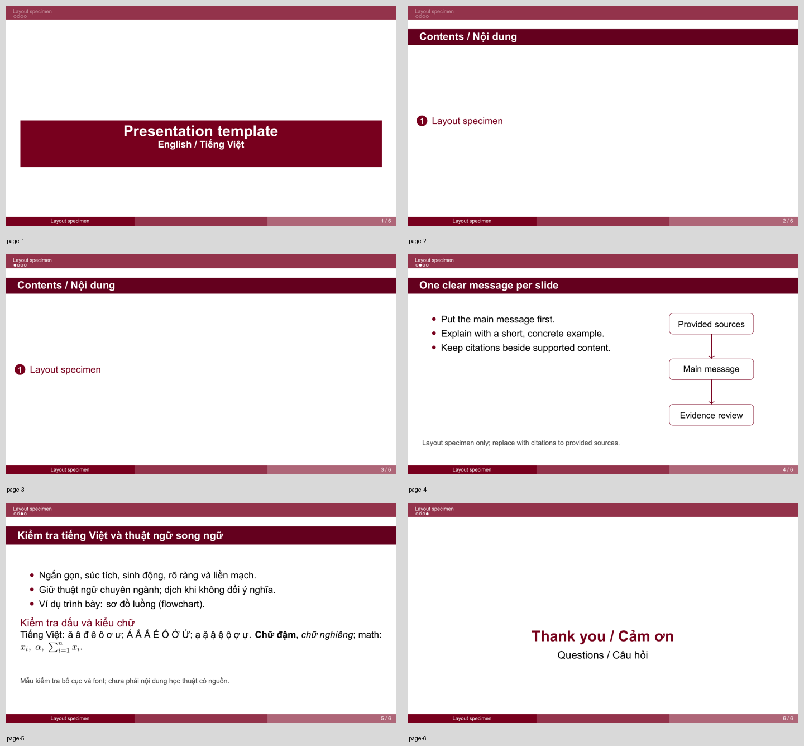

# Source to LaTeX Slides

A Codex skill for turning provided papers, PDFs, notes, and links into concise, source-grounded academic Beamer presentations in **English or Vietnamese**.

Required deliverables: an actual **compiled PDF**, editable **LaTeX source**, and the supporting files needed to rebuild it.



[View the compiled template specimen](examples/template-preview.pdf). This is a layout/font test, not a sourced research presentation.

## Install on another computer

In Codex, ask:

```text
Use $skill-installer to install the skill from
https://github.com/nguyenhaiyenedu06/source-to-latex-slides
at path skills/source-to-latex-slides.
```

Alternatively, download the repository and place the entire `skills/source-to-latex-slides` folder in your personal Codex skills directory. Start a new chat if it has not appeared in the available skill list yet.

## Use

```text
Use $source-to-latex-slides to create a presentation from the sources I provide.
```

The skill asks for language, audience, objective, duration (including or excluding Q&A), and source priorities. It proposes a deductive, inductive, or mixed narrative, and shows an outline, cover, and sample content slide before building the full presentation unless you request an uninterrupted build.

## What it does

- Preserves technical terms; pairs accurate Vietnamese translations with original terms when useful.
- Explains difficult ideas using concrete examples accessible to high-school students without changing scientific meaning.
- Requires citations for every substantive claim, equation, number, figure, diagram, and scientific explanation.
- Uses original source figures or charts redrawn from original data; draws flowcharts and diagrams with code.
- Restricts ImageGen to non-evidentiary illustrative artwork; never generates research evidence or experimental results.
- Requires independent agent review of citations against the actual sources.
- Preserves the supplied template layout without SCU logos or institutional branding; chooses coherent topic-specific colors and illustrative imagery per deck.
- Compiles to a saved PDF and visually checks every rendered page for clipping, overlap, legibility, font consistency, and Vietnamese glyphs.

## Requirements and portability

- Codex with access to files and a compatible compiler: XeLaTeX, LuaLaTeX, or Tectonic. Compiler software is not bundled; install it on each computer.
- The template is a 16:9 Beamer project using `fontspec` and TikZ. Its font preference is TeX Gyre Heros, falling back to Arial or Latin Modern Sans; verify the selected font's Vietnamese glyphs.
- Source-reading and PDF rendering tools. ImageGen is needed when creating fresh illustrative artwork. Independent agents are needed for the required citation audit; the skill reports the audit incomplete if they are unavailable.
- Network access as needed to read provided links or download missing TeX support packages. Files supplied by you remain the source set unless you authorize expansion.

Example local compilation, from a copy of `skills/source-to-latex-slides/assets/beamer/`:

```text
tectonic --keep-logs main.tex
```

The output `main.pdf` is the compiled specimen. A real presentation replaces specimen text and adds source citations, topic-specific visuals, and bibliography.

## License and attribution

Distributed under GPL-3.0; see [LICENSE](LICENSE). The Beamer theme is derived from WQT1123's [University-Presentation-Beamer](https://github.com/WQT1123/University-Presentation-Beamer), corresponding to the user-selected [SCU template on Overleaf](https://www.overleaf.com/latex/templates/scu-presentation-beamer/bfdsdqwymqsq).

See [template provenance](skills/source-to-latex-slides/assets/beamer/PROVENANCE.md) for the upstream license distinction and modifications. Attribution is retained in project files; no upstream campus photos or logos are included.

## Tiếng Việt

Skill tạo slide học thuật ngắn gọn, súc tích, sinh động, rõ ràng và liền mạch từ tài liệu được cung cấp. Mỗi bài hỏi chọn tiếng Anh hoặc tiếng Việt, đối tượng nghe và thời lượng; có kiểm tra citation bằng agent độc lập. Đầu ra bắt buộc là PDF đã biên dịch cùng mã nguồn `.tex` và các tệp phụ thuộc. Máy khác cần cài compiler riêng; bản skill không chứa compiler hay tài liệu cá nhân của người tạo.
